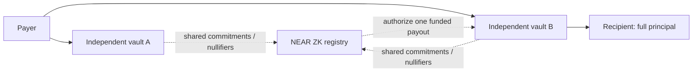

# Core Contract — distributed custody, shared ZK notes

[English](README.md) · [한국어](README.ko.md) · [简体中文](README.zh-CN.md)

Private business settlement on NEAR: independent vaults hold principal, shared zero-knowledge notes authorize payouts, and selective evidence supports reconciliation.

Contract is the Rust/WASM contracts, circuit and public vectors repository.

An opt-in [cover-traffic experiment](https://github.com/Company-privacy-settlement/Core/blob/main/docs/COVER_TRAFFIC.md) now runs bounded operator-owned native notes on testnet. Four transactions finalized; the 0.1 NEAR principal returned to its operator. The synthetic probe had six historical output candidates, three after excluding labelled artificial outputs. Independent participants added: **0**. Budget/frequency limits persist across restart; this is not an anonymity claim.

[Payment security review](https://github.com/Company-privacy-settlement/Core/blob/main/docs/REVIEW-2026-11-14-PAYMENT-SECURITY.md): fixed same-note reservation aliases across policy metadata, including legacy conflicts. Validation covers double spends, competing liquidity, failure accounting, immutable approval and revocation: **582 Core tests** and **63 contract tests**. Corporate approval remains an API/SDK control; public valid-proof execution is permissionless.

[Actual-provider qualification](https://github.com/Company-privacy-settlement/Core/blob/main/docs/PROVIDER_QUALIFICATION.md) now has read-only Sumsub state checks and source/signed-review gates. Four of six official source hashes matched in the dated run. Live credentials, authorized cases and external signed reviews were absent, so actual KYB/tax-provider acceptance remains **blocked**. Deactivation and beneficiary-structure event handling were corrected.

## The idea

Businesses need to pay suppliers, employees and contractors without putting invoice terms and business records on-chain. Core combines signed payment requests, local proofs and reviewable evidence while keeping custody distributed across vaults.

[Hackathon guide](https://github.com/Company-privacy-settlement/Core/blob/main/docs/HACKATHON.md) · [Web Docs](https://core-private-settlement-0574c4.jiheon6768.chatgpt.site/docs/) · [Core](https://github.com/Company-privacy-settlement/Core) · [Contract](https://github.com/Company-privacy-settlement/Contract) · [Front](https://github.com/Company-privacy-settlement/Front)

## Watch the demo

[](https://github.com/Company-privacy-settlement/Front/blob/main/public/media/core-hackathon-demo-en.mp4)

[Watch English MP4](https://github.com/Company-privacy-settlement/Front/blob/main/public/media/core-hackathon-demo-en.mp4) · [Captions, transcript & chapters](https://github.com/Company-privacy-settlement/Front/blob/main/docs/HACKATHON_DEMO.md) · [Hosted video player](https://core-private-settlement-0574c4.jiheon6768.chatgpt.site/media/)

English narration, captions and actual application screens. Browser segments use labelled wallet/API fixtures and real local proof generation. A separate section shows the recorded native NEAR public-testnet run.

Repository and Site access follow their existing permissions. Demo media is stored in Front; reviewers need Front access, or the downloadable video bundle. No sharing permissions are changed by this submission.

## What is built

| Capability | Implementation |
| --- | --- |
| Forest | Shared commitment tree/nullifiers and asynchronous settlement coordination. |
| Independent vaults | Principal held per vault; one eligible funded vault pays a recipient directly. |
| Native + FT | Native NEAR v2 and token-bound NEP-141/USDC v3 with additive protocol fees. |
| Failure recovery | Original nullifier/vault/recipient preserved across retry; deposit refund and liability accounting. |
| Verification | Pinned embedded vault/verifier bytes, keyless code and real WASM/Groth16 integration. |

## Run locally

Node.js 22.16+, Rust 1.99.1, the wasm32-unknown-unknown target and documented native build dependencies. Keep Core and Contract as sibling checkouts for proving/setup demos. Setup for a new group uses a new verifier; do not replace an existing group’s artifacts.

```bash
npm ci
npm run build
npm test
# Build local NEP-141 test fixture when needed
npm run build:test-ft
```

```bash
# From sibling Core/, using an existing matching development setup:
npm run zk:setup
npm run demo:shared
npm run demo:ft
```

## Real testnet evidence

**14 actual public-testnet transactions reached FINAL** on 2026-11-14: deploy/seal, two 0.1 NEAR deposits, payouts and an actual missing-recipient failure recovered to the original destination. Both recipients received the full 0.1 NEAR; retry charged no second protocol fee. Registry and both vaults were keyless. A separate read-only verifier checked receipts, signatures, historical before/after balances and 0.0006 NEAR collected protocol fees.

[Testnet run and transaction links](https://github.com/Company-privacy-settlement/Core/blob/main/docs/TESTNET_WALLET.md) · [Public evidence](https://github.com/Company-privacy-settlement/Core/blob/main/docs/evidence/testnet-wallet-2026-11-14.json)

Latest recorded engineering gate: **513 Core tests** passed, with SDK/type builds and compiled service restart/backup/recovery. Browser fixtures and public native execution are separate evidence categories.

## Architecture and fees



Deposit and withdrawal each add **0.15%**. The recipient receives the full principal. NEAR action storage, registration, activation and network gas are separate.

The ZK statement hides which input note is spent. Signers, recipients, timing, fixed amounts, vaults and funding edges remain public. This single-payer run does not establish effective anonymity. A separate opt-in testnet tool labels operator cover activity; a group currently supports 256 total outputs.

## Scope and next steps

**Hackathon / development prototype.** The setup is `UNSAFE_LOCAL_DEVELOPMENT_ONLY`. Public-testnet qualification covers native NEAR with a local Ed25519 software wallet. Real browser-wallet/USDC execution, hosted API HTTPS acceptance, observed remote Actions success and production security review remain open.

Next priorities: externally hosted relay qualification, independent participation and stronger adversarial privacy measurements. Live KYB/AI providers, professional rule approval and statutory filing require separate qualification.

## Explore the project

[Service](https://github.com/Company-privacy-settlement/Core/blob/main/docs/SERVICE.md) · [Privacy](https://github.com/Company-privacy-settlement/Core/blob/main/docs/PRIVACY.md) · [Invoices](https://github.com/Company-privacy-settlement/Core/blob/main/docs/INVOICE_PAYMENTS.md) · [Organizations](https://github.com/Company-privacy-settlement/Core/blob/main/docs/ORGANIZATIONS.md) · [Tax drafts](https://github.com/Company-privacy-settlement/Core/blob/main/docs/TAX_DRAFTS.md) · [Deployment](https://github.com/Company-privacy-settlement/Core/blob/main/docs/DEPLOYMENT.md) · [Hosting](https://github.com/Company-privacy-settlement/Core/blob/main/docs/PRODUCTION_HOSTING.md) · [CI](https://github.com/Company-privacy-settlement/Core/blob/main/docs/CI.md) · [Roadmap](https://github.com/Company-privacy-settlement/Core/blob/main/docs/ROADMAP.md)
