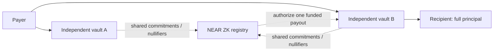

# Core Contract — distributed custody, shared ZK notes

[English](README.md) · [한국어](README.ko.md) · [简体中文](README.zh-CN.md)

基于 NEAR 的企业隐私结算：独立金库持有本金，共享零知识票据授权付款，选择披露证据用于对账。

Contract 仓库提供 Rust/WASM 合约、电路及公共向量。

可选的 [Cover traffic 实验](https://github.com/Company-privacy-settlement/Core/blob/main/docs/COVER_TRAFFIC.md)仅在测试网使用运营者自己的原生票据。四笔交易已最终确认，0.1 NEAR 本金已返回运营者。合成提款的历史输出候选为六个，排除标记的人工输出后为三个。新增独立参与者为 **0**；预算与频率限制在重启后仍保留。这不证明有效匿名性。

## 项目简介

企业需要向供应商、员工和承包商付款，同时避免将发票条款及业务文档公开上链。Core 结合收款人签名请求、本地证明和可审核证据，并将本金分布在独立金库中。

[Hackathon guide](https://github.com/Company-privacy-settlement/Core/blob/main/docs/HACKATHON.md) · [Web Docs](https://core-private-settlement-0574c4.jiheon6768.chatgpt.site/docs/) · [Core](https://github.com/Company-privacy-settlement/Core) · [Contract](https://github.com/Company-privacy-settlement/Contract) · [Front](https://github.com/Company-privacy-settlement/Front)

## 观看演示

[](https://github.com/Company-privacy-settlement/Front/blob/main/public/media/core-hackathon-demo-en.mp4)

[Watch English MP4](https://github.com/Company-privacy-settlement/Front/blob/main/public/media/core-hackathon-demo-en.mp4) · [Captions, transcript & chapters](https://github.com/Company-privacy-settlement/Front/blob/main/docs/HACKATHON_DEMO.md) · [Hosted video player](https://core-private-settlement-0574c4.jiheon6768.chatgpt.site/media/)

提供英文旁白、字幕及真实应用画面。浏览器片段标明钱包/API 测试环境，并生成真实本地证明。独立章节展示已记录的原生 NEAR 公开测试网验证。

仓库与站点保留现有访问权限。视频位于 Front；评审需要 Front 权限或下载的视频包。本次提交准备不改变共享范围。

## 已实现功能

| 能力 | 实现 |
| --- | --- |
| Forest | 共享承诺树/nullifier 与异步结算协调。 |
| 独立金库 | 本金分别持有，由有资金的合格金库直接付款。 |
| 原生与 FT | 原生 NEAR v2、绑定代币的 NEP-141/USDC v3，本金外加费用。 |
| 失败恢复 | 重试保持原 nullifier/金库/收款人，包含入金退款及负债会计。 |
| 验证 | 固定内嵌金库/验证器字节、无密钥代码及真实 WASM/Groth16 集成。 |

## 本地运行

需要 Node.js 22.16+、Rust 1.99.1、wasm32-unknown-unknown 目标及文档中的本机构建依赖。证明/结算演示需将 Core 与 Contract 放在同级目录。新分组设置使用新验证器，不替换已有分组文件。

```bash
npm ci
npm run build
npm test
# Build local NEP-141 test fixture when needed
npm run build:test-ft
```

```bash
# From sibling Core/, using an existing matching development setup:
npm run zk:setup
npm run demo:shared
npm run demo:ft
```

## 真实测试网证据

2026-11-14 确认 **14 笔真实公开测试网交易达到 FINAL**：部署/移除密钥、两笔 0.1 NEAR 入金、付款，以及收款账户不存在后向原目的地恢复。两名收款人均收到完整 0.1 NEAR，重试无第二次协议费。注册表与两个金库均无访问密钥；独立只读验证程序重新查询收据、签名、历史前后余额及合计 0.0006 NEAR 协议费。

[Testnet run and transaction links](https://github.com/Company-privacy-settlement/Core/blob/main/docs/TESTNET_WALLET.md) · [Public evidence](https://github.com/Company-privacy-settlement/Core/blob/main/docs/evidence/testnet-wallet-2026-11-14.json)

最近记录的工程验证为 **513 项 Core 测试**、SDK/类型构建及编译服务重启/备份/恢复。浏览器测试环境与公开原生实交易证据分别记录。

## 架构与费用



入金与出金各在本金之外加收 **0.15%**。收款人收到完整本金。NEAR 操作存储、代币注册、账户激活及网络 gas 单独计算。

ZK 隐藏使用了哪一张输入票据。签名人、收款人、时间、固定金额、金库及资金来源仍公开。单一付款人测试不证明有效匿名性。独立测试网实验工具会标记运营者的人工活动；每组总输出上限为 256。

## 范围与后续工作

**黑客松/开发原型**，设置为 `UNSAFE_LOCAL_DEVELOPMENT_ONLY`。公开测试网验证仅覆盖本地 Ed25519 软件钱包的原生 NEAR。真实浏览器钱包/USDC、外部 API HTTPS 验收、远程 Actions 成功及生产安全审核尚待完成。

下一步优先外部托管中继验证、独立参与者与更严格的对抗性隐私测量。真实 KYB/AI 服务资格、专业规则批准和法定申报仍需独立验证。

## 探索项目

[Service](https://github.com/Company-privacy-settlement/Core/blob/main/docs/SERVICE.md) · [Privacy](https://github.com/Company-privacy-settlement/Core/blob/main/docs/PRIVACY.md) · [Invoices](https://github.com/Company-privacy-settlement/Core/blob/main/docs/INVOICE_PAYMENTS.md) · [Organizations](https://github.com/Company-privacy-settlement/Core/blob/main/docs/ORGANIZATIONS.md) · [Tax drafts](https://github.com/Company-privacy-settlement/Core/blob/main/docs/TAX_DRAFTS.md) · [Deployment](https://github.com/Company-privacy-settlement/Core/blob/main/docs/DEPLOYMENT.md) · [Hosting](https://github.com/Company-privacy-settlement/Core/blob/main/docs/PRODUCTION_HOSTING.md) · [CI](https://github.com/Company-privacy-settlement/Core/blob/main/docs/CI.md) · [Roadmap](https://github.com/Company-privacy-settlement/Core/blob/main/docs/ROADMAP.md)
